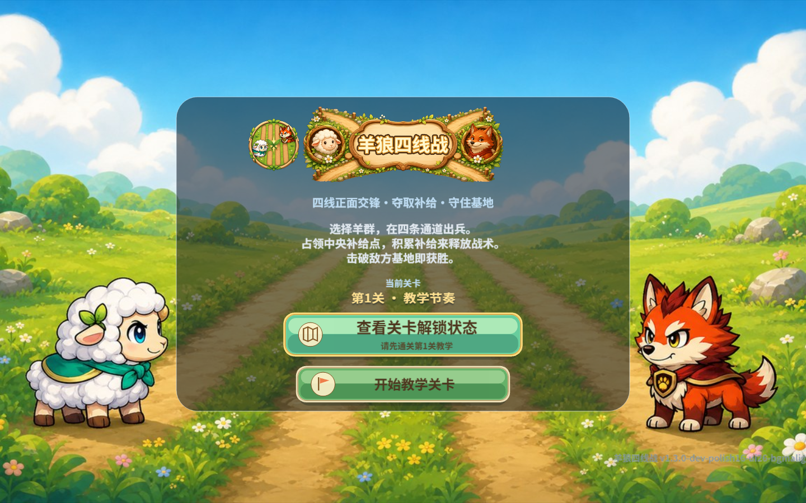

# 羊狼四线战 (WolfSheepBattle)

[中文](README.md) | **English**

A turn-based tactics mini-game for the WeChat Mini Game platform, built with **Cocos Creator 3.8.8**.

Players deploy units across four battle lines and fight turn by turn, combining troop composition with tactic cards. The repository contains the complete game source — scenes, TypeScript gameplay code, runtime art, audio and the original art source files.



[](https://wakeup595626-cmyk.github.io/WolfSheepBattle/)
[](https://github.com/wakeup595626-cmyk/WolfSheepBattle/releases)
[](LICENSE)
[](package.json)
[](#build-from-source)

## Play

**Play in your browser** (no install required): **https://wakeup595626-cmyk.github.io/WolfSheepBattle/**

The WeChat Mini Game build is available under [Releases](https://github.com/wakeup595626-cmyk/WolfSheepBattle/releases). Download the archive, import the extracted folder into WeChat DevTools, and supply your own AppID.

## Build from source

1. Install **Cocos Creator 3.8.8** (the version is pinned in `package.json` under `creator.version`).
2. Open this folder with Cocos Creator — it will regenerate `library/`, `temp/` and `build/`.
3. Open `assets/scenes/Battle.scene` to preview inside the editor.
4. To build: **Project — Build** and pick the *WeChat Mini Game* (or *Web Mobile*) platform.

> Replace the AppID with your own before building. The AppIDs appearing in historical QA records belong to the original author; they are useless without the matching upload key, but please do not reuse them.

## Project layout

| Path | Description |
|---|---|
| `assets/` | The game project: scenes, TypeScript scripts, prefabs, runtime assets |
| `art_source/` | Original art source files (characters, UI, battlefield, VFX) |
| `tools/` | Build, QA and release-validation scripts |
| `THIRD_PARTY_LICENSES/` | Font licenses |
| `THIRD_PARTY_AUDIO.md` | Per-track BGM provenance (source, author, SHA-256) |
| `docs/reports/*.md` | Per-version development reports, kept as a development record |

## Third-party notices

Fonts are licensed under the terms in `THIRD_PARTY_LICENSES/`. Background music comes from **Pixabay** (free for commercial use) and each track is documented in `THIRD_PARTY_AUDIO.md`. Everything else — code and art — is original work.

See [THIRD_PARTY_NOTICES.md](THIRD_PARTY_NOTICES.md).

## Community and support

- Report bugs through [GitHub Issues](https://github.com/wakeup595626-cmyk/WolfSheepBattle/issues).

## Contributing

See [CONTRIBUTING.md](CONTRIBUTING.md).

## Citation

```bibtex
@misc{wolfsheepbattle,
  title={WolfSheepBattle (羊狼四线战)},
  author={wakeup595626-cmyk},
  year={2026},
  publisher={GitHub},
  howpublished={\url{https://github.com/wakeup595626-cmyk/WolfSheepBattle}},
}
```

## License

[MIT](LICENSE)
